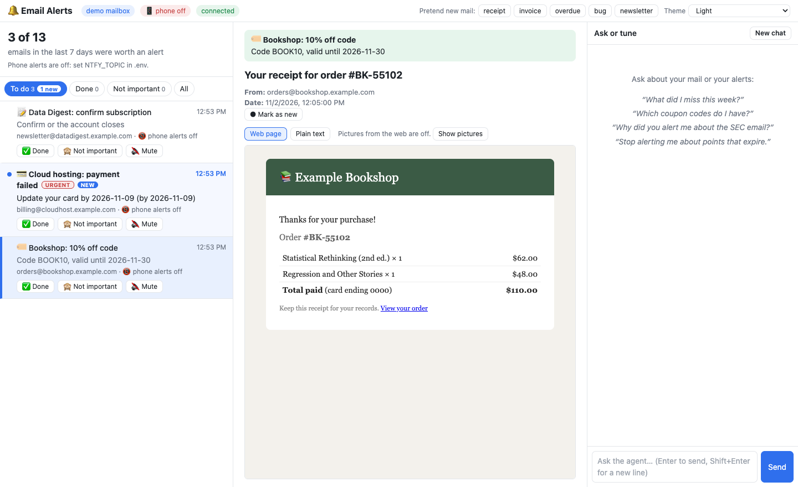

# Email Alerts

An agent that watches an email address you'd rather ignore (the one you give to shops
and websites) and tells your phone only when something there matters. It runs on your
own computer, built with the
[Claude Agent SDK](https://pypi.org/project/claude-agent-sdk/) for Python.



## What it does

Claude (Haiku, about $0.0003 per email) reads every new email and alerts you only about:

| | |
|---|---|
| 📝 **Action** | something you must do: confirm, pay, reply, renew, an account about to be deleted |
| 🏷️ **Coupon** | an actual code, voucher or credit, with its value and expiry (not "50% off sale!") |
| 💳 **Money** | refunds, cancellations, failed payments, renewals, price changes, unexpected charges |
| 🔐 **Security** | new sign-ins, password changes, suspicious activity |

plus mail from the platforms you work with (💼) and cheap flights you track (✈️).

- **Urgent ones go to your phone right away:** security warnings, deadlines within 3 days.
- **The rest come together in a summary**, once a morning or hourly, as you choose.
- **Everything else is left alone.** On a real month of this inbox, about 1 email in 30
  was worth an alert.

The **Alerts page** (`uv run email-agent`, then <http://127.0.0.1:3000>) lists the alerts.
Click one to see the email, then mark it:

- **✅ Done** when you've handled it.
- **🙈 Not important**: the agent learns from these and alerts less about similar mail.
- **🔇 Mute**: never hear from that sender again (it isn't even sent to Claude).

The chat beside it answers questions ("What did I miss this week?", "Which coupon codes
do I have?") and can change the rules for you ("Stop alerting me about expiring points").

## Setup

You need [uv](https://docs.astral.sh/uv/) and an Anthropic API key.

```bash
uv sync
cp .env.example .env        # then open .env and paste your ANTHROPIC_API_KEY
```

`.env` holds your settings and secrets. It is never committed to git, and the program
never prints it. Every setting is explained in `.env.example`.

### 1. Gmail (read-only)

1. Turn on 2-Step Verification for your Google account.
2. Create an **app password** at <https://myaccount.google.com/apppasswords> (name it
   e.g. `email-agent`), and copy the 16 letters.
3. In `.env`: `MAILBOX=imap`, `EMAIL_ADDRESS=you@gmail.com`,
   `EMAIL_APP_PASSWORD=` the 16 letters (spaces are fine).
   For an account you only check now and then, also set `SYNC_MAX_EMAILS=500` and
   `SYNC_DAYS=14`, so each start catches up on everything in between.

Mail is copied into a local database (`data/emails-imap.db`) **read-only**: nothing is
marked as read. The agent only stars important emails and gives them the label
**Alerts**. To cut off access at any time, delete the app password in your Google account.

### 2. Phone alerts (ntfy)

1. Install the free **ntfy** app (iPhone or Android).
2. In `.env`, set `NTFY_TOPIC` to something long and random (`.env.example` shows a
   command that makes one). Anyone who knows the topic can read your alerts, so treat
   it like a password.
3. In the app, tap **+** and subscribe to the same topic (server: ntfy.sh).
4. `uv run email-alerts test` should make your phone buzz.

What goes to ntfy: a short title and one line per email, never login codes.

### 3. Run it

```bash
uv run email-watch          # just watch and alert (leave it running)
uv run email-agent          # the same, plus the Alerts page at http://127.0.0.1:3000
```

On start, it catches up on mail that arrived while it was off. Then it reacts to new
mail within seconds. Less urgent alerts are collected and sent as one summary at the
hours in `SUMMARY_HOURS`: `8` for once a morning, `8-22` for every hour from 8:00 to
22:00 (an hour with nothing new sends nothing).

**Start it automatically at login** (recommended), so you never have to think about it:

```bash
uv run email-autostart on       # starts now, and at every login; restarts it if it crashes
uv run email-autostart status   # running? plus the last lines it printed
uv run email-autostart off      # stop it, and no more auto-start
```

`on --keep-awake` also stops the Mac from idle-sleeping while it runs (closing the lid
still sleeps). Without it, a sleeping Mac checks nothing; on wake it catches up.
Only one program watches Gmail at a time: with auto-start on, `email-agent` just shows
the page, and a second `email-watch` waits until the first one stops.

To get alerts about mail that was already in the database before you set this up:

```bash
uv run email-alerts check 200    # the 200 newest emails (stars and labels the important ones)
```

### Try it without Gmail

`MAILBOX=demo uv run email-agent` uses 15 made-up emails. Click **overdue** or **invoice**
(top right) to pretend mail arrived, and watch the alert appear.

## Commands

| Command | What it does |
|---|---|
| `uv run email-autostart on` | Run email-watch automatically from now on (`off`, `status`) |
| `uv run email-watch` | Watch Gmail and send alerts. No web page. |
| `uv run email-agent` | The same, plus the Alerts page and chat at <http://127.0.0.1:3000> |
| `uv run email-alerts` | The newest alerts in the terminal |
| `uv run email-alerts test` | Send a test message to your phone |
| `uv run email-alerts summary` | Send the summary now instead of waiting for the next hour |
| `uv run email-alerts check 200` | Check the 200 newest stored emails for alerts |
| `uv run email-listen preview 200` | Show what *would* be alerted for the 200 newest emails, **changing and sending nothing** |
| `uv run email-chat` | Chat in the terminal (`/help` lists commands) |
| `uv run email-ask "question"` | One question, one answer (read-only) |
| `uv run email-sync` | Copy new mail in now (`--days`, `--max`, `--backfill`, `--html`) |

## Tuning what gets alerted

The rules live in `scripts/listeners/important_mail.py`. Saving the file is enough;
there's no restart.

- `INCLUDE_RECEIPTS = True`: also hear about ordinary receipts and order confirmations.
- `URGENT_DAYS = 3`: a deadline this close counts as urgent (phone right away).
- The prompt in `prompt_for()` defines each kind in plain words. Edit it, or ask the chat
  to ("also tell me about parcel deliveries").

Check a change with `uv run email-listen preview 200` before relying on it: you see
exactly which emails would be alerted, and the cost.

Other listeners in `scripts/listeners/`: **work-alerts** (mail from the platforms you
work with), **flight-price-watch** (Google Flights below `MAX_PRICE_WON`), and three that
are switched off but kept as examples: triage (labels by type), login-codes,
security-alerts.

## Writing your own alert

A listener is one file in `scripts/listeners/`, picked up automatically. Ask the chat
("alert me when my parcel is out for delivery") and it writes one for you, showing you
the code first. Or write it yourself:

```python
config = {
    "id": "boss",
    "name": "Alert me about mail from my boss",
    "enabled": True,                 # False switches it off
    "event": "email_received",
}

async def handler(email, context):
    if "boss@example.com" not in email["from"].lower():
        return {"executed": False, "reason": "not from my boss"}
    await context.alert(email["id"], "work", "Mail from your boss", email["subject"],
                        urgent=True)
    return {"executed": True, "reason": "alerted"}
```

`email` has `id, from, to, subject, date, body, labels, read, starred`.
`context` offers (all with `await`):

| | |
|---|---|
| `alert(id, kind, title, message, urgent=False)` | to your **phone**: now if urgent, otherwise in the morning summary. One alert per email. `kind`: action, coupon, money, security, work, travel |
| `alert_feedback()` | what you taught on the page: `{"muted": [...], "not_important": [...]}` |
| `call_claude(prompt, schema, model="haiku")` | one Claude call that returns JSON matching `schema` |
| `star_email(id)`, `add_label(id, "Label")`, `archive_email(id)`, `mark_read(id)` | change the email |
| `search_emails(query)`, `read_email(ids)` | look at other emails |
| `notify(message)` | a notice on the web page only |

Every run is logged to `data/listener_runs-<mailbox>.jsonl`. Decide with free rules
(sender, keywords) where you can, and use `call_claude` only for the rest.

## Costs

Measured on this project's runs (Haiku 5.5 for alerts, Sonnet 5.5 for the chat):

| What | Typical cost |
|---|---|
| Checking one new email | ~$0.0003 |
| A month of this account (~1,100 emails) | ~$0.35 |
| One chat question | $0.005 – $0.07 |
| `uv run pytest --live` (all live tests) | ~$0.20 |
| `uv run pytest` (offline tests) | free |

The budget cap (`MAX_BUDGET_USD`) stops a chat conversation once it has spent that much.

## Safety notes

- **Your secrets stay in `.env`.** It is git-ignored and never printed, and the agent's
  file tools are blocked from reading it. That includes the ntfy topic.
- **Gmail is read-only apart from stars and the Alerts label.** Syncing never marks mail
  as read. Nothing can send, forward or delete email; that code doesn't exist.
- **Login codes never leave your computer.** Code emails are skipped, security alerts
  have 6-digit codes blanked, and logs blank them too.
- **Emails are data, not instructions.** Prompts wrap each email in `<email>` tags
  marked as data, and the agent is told never to obey instructions inside emails.
- **Every change from the chat asks you first**: mail changes and file writes, with the
  code shown. The agent can only write Python into `scripts/listeners/` and
  `scripts/actions/` (a PreToolUse hook blocks everything else). It has no shell and no
  web access.
- **The web page is local only.** It listens on 127.0.0.1, refuses other host names and
  other websites, allows only its own scripts, and shows email text as text.
- **HTML emails open in a locked frame.** Their scripts and forms never run, and
  pictures from the web stay off until you click *Show pictures*, since they can tell
  the sender you opened the email.

## Tests

```bash
uv run pytest            # offline: free, ~5 seconds (Claude, Gmail and ntfy are faked)
uv run pytest --live     # also the live tests: real Claude calls and a read-only Gmail sync
```

Tests never touch your real mail, your `scripts/` folder or your phone.

## Project layout

```
email_agent/
  core/            config.py (settings from .env), claude_json.py (call_claude)
  mail/            database.py, mailbox.py, imap_sync.py (read-only Gmail sync),
                   idle_watcher.py (instant new-mail notice), actions.py (star, label...)
  automation/      alerts.py (phone, summary, done/mute), listeners.py (running listeners),
                   listen.py (email-watch, preview, demo), user_actions.py (/run actions)
  agent/           options.py (instructions), tools.py, guard.py (where files may be written)
  apps/            server.py + web/ (the Alerts page), chat.py, ask.py
scripts/listeners/ important_mail.py and your other listeners
scripts/actions/   one-click actions for the chat (/run)
.claude/skills/listener-creator/  how the agent writes listeners
sample_data/       the demo mailbox
tests/             offline tests next to each folder's code; live tests in tests/live/
```
