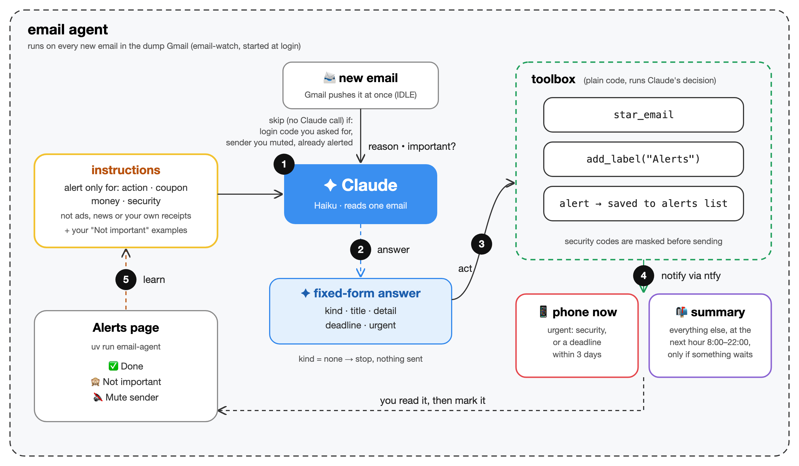

# Email Agent

An email agent that watches an email address you'd rather ignore (the one you give to
shops and websites) and tells your phone only when something there matters. It runs on
your own computer: Claude Haiku (through the Anthropic API) sorts the mail, and the chat
is built with the [Claude Agent SDK](https://pypi.org/project/claude-agent-sdk/) for
Python.

**Works with any mailbox that offers IMAP**, the standard way mail apps connect:

| Gmail | Outlook / Hotmail | iCloud Mail | Yahoo Mail | Others (Fastmail, Naver, your company's mail...) |
|:---:|:---:|:---:|:---:|:---:|
| ✅ ready | ✅ ready | ✅ ready | ✅ ready | ✅ set the server name |

The first four are set up for you: the agent picks the right server from your address.

<p align="center">
  
</p>

**How it works, for each new email:**

1. **Reason:** a model reads it, along with the instructions (which kinds matter, and
   your past "Not important" examples). This project uses Claude Haiku. Login codes you
   asked for and muted senders are skipped without calling the model.
2. **Answer:** the model fills in a fixed form: kind, title, detail, deadline, urgent.
   Kind "none" means not important, and nothing happens.
3. **Act:** plain code carries out the answer: it stars (flags) the email in your
   mailbox, labels it "Alerts" if your mailbox has labels, and saves the alert.
4. **Notify:** urgent alerts go to your phone at once (via ntfy). The rest wait for the
   summary.
5. **Learn:** what you mark on the Alerts page (Done, Not important, Mute) shapes the next
   decisions.

The diagram's source is [docs/agent-diagram.svg](docs/agent-diagram.svg).

<p align="center">
  
</p>

## Contents

- [What it does](#what-it-does)
- [What you need](#what-you-need)
- [Install](#install)
- [Try it with made-up emails](#try-it-with-made-up-emails)
- [Set it up for your mailbox](#set-it-up-for-your-mailbox): 1. connect your email,
  2. phone alerts, 3. run it
- [Everyday use](#everyday-use) and [Commands](#commands)
- [Settings](#settings)
- [Tuning what gets alerted](#tuning-what-gets-alerted) and
  [Writing your own alert](#writing-your-own-alert)
- [Costs](#costs), [Troubleshooting](#troubleshooting), [Safety notes](#safety-notes)
- [Updating and uninstalling](#updating-and-uninstalling), [Tests](#tests),
  [Project layout](#project-layout)

## What it does

Claude Haiku (about $0.0003 per email) reads every new email, except login-code emails
and senders you muted, and alerts you only about:

| | |
|---|---|
| 📝 **Action** | something you must do: confirm, pay, reply, renew, an account about to be deleted |
| 🏷️ **Coupon** | an actual code, voucher or credit, with its value and expiry (not "50% off sale!") |
| 💳 **Money** | refunds, cancellations, failed payments, renewals, price changes, unexpected charges |
| 🔐 **Security** | new sign-ins, password changes, suspicious activity |

Two small rule-based listeners can add more, without Claude: mail from the places you
work (💼, if you list them in `WORK_SENDERS`) and Google Flights price alerts below your
target (✈️).

- **Urgent ones go to your phone right away:** security warnings, deadlines within 3
  days, anything Claude judges can't wait, and the work and flight alerts.
- **The rest come together in a summary**, once a morning or every hour, as you choose.
- **Everything else is left alone.** On 200 real emails from a throwaway inbox, 7 were
  worth an alert (about 1 in 30).
- **Each important email is starred (flagged) in your mailbox**, so you can also find
  them in your usual mail app. Mailboxes with labels (Gmail) also get the label "Alerts".

The **Alerts page** (<http://127.0.0.1:3000> while `uv run email-agent` runs) lists the
alerts, with how many emails arrived this week and how many were worth an alert. The
**To do** tab holds alerts you haven't handled yet. Click one to see the email (as a web
page or plain text), then mark it:

- **✅ Done** when you've handled it. Handled alerts stay out of the next summary.
- **🙈 Not important**: Claude is shown your 20 most recent "not important" alerts as
  examples, and skips emails of the same kind from the same sender or about the same thing.
- **🔇 Mute**: no more alerts from that sender, from any listener. Its emails aren't
  even sent to Claude any more.

Alerts you haven't opened yet are **bold with a dot and a NEW tag**, like unread mail, and
their number shows on the To do tab and in the browser tab, e.g. "(2) Email Alerts".
Opening one removes the tag (on every browser, and it stays that way after a restart);
**● Mark as new** in the email puts it back. An alert stays in To do until you mark it. The **Theme** menu at the top
switches between Auto (follows your computer), Light, Dark, Paper (warm, easy on the eyes)
and High contrast; the page remembers your choice.

The chat beside it answers questions about your mail and alerts ("What did I miss this
week?", "Which coupon codes do I have?"). It can also edit the alert rules for you ("Stop
alerting me about expiring points"): it shows you the change and asks before saving.

## What you need

- **A Mac or a Linux computer** that is on when mail arrives. Everything runs on it;
  nothing is hosted elsewhere. Starting automatically at login (`email-autostart`) is
  macOS only; on Linux you start `email-watch` yourself or with your own tools. Windows
  isn't supported (it may work inside WSL, untested).
- **[uv](https://docs.astral.sh/uv/)**, which installs Python (3.12 or newer) and
  everything else for you.
- **An Anthropic API key** from <https://console.anthropic.com/settings/keys>. It is
  pay-as-you-go; a busy inbox costs well under $1 a month (see [Costs](#costs)).
- **An email account with IMAP:** Gmail, Outlook, iCloud Mail, Yahoo Mail or another.
- **A phone with the free ntfy app**, for the alerts (optional: without it you see the
  alerts on the web page only).

## Install

1. Install uv (skip if `uv --version` already works):

   ```bash
   curl -LsSf https://astral.sh/uv/install.sh | sh
   ```

   Then open a new terminal window, so the `uv` command is found.

2. Get the code and install it:

   ```bash
   git clone https://github.com/syounlee/email-agent.git
   cd email-agent
   uv sync
   ```

3. Create your settings file and add your API key:

   ```bash
   cp .env.example .env
   open -e .env        # macOS; on Linux use any text editor, e.g. nano .env
   ```

   Paste your key after `ANTHROPIC_API_KEY=` and save. `.env` holds your settings and
   secrets: it is never committed to git, and the program never prints it. Every
   setting is explained in it, and listed under [Settings](#settings).

All commands below are run inside the `email-agent` folder.

## Try it with made-up emails

A fresh `.env` starts in demo mode (`MAILBOX=demo`), so this works right away:

```bash
uv run email-agent
```

Open <http://127.0.0.1:3000>. The demo mailbox holds 15 made-up emails. Click
**overdue** or **invoice** (top right) to pretend mail arrived, and watch the alert
appear. Claude really reads the demo emails (a fraction of a cent each). Press Ctrl+C in
the terminal to stop.

If you've already set up your phone and real mailbox, you can still try the demo
without buzzing your phone:

```bash
MAILBOX=demo NTFY_TOPIC= uv run email-agent
```

## Set it up for your mailbox

### 1. Connect your email (read-only)

The four biggest services are set up for you: the agent picks the right server from your
address (gmail.com, outlook.com, icloud.com, yahoo.com...). In `.env`, set
`MAILBOX=imap` and `EMAIL_ADDRESS=` your address, then follow your provider:

| Provider | How it signs in | Important mail is... |
|---|---|---|
| **Gmail** | app password | starred and labeled **Alerts** |
| **Outlook / Hotmail** | Microsoft sign-in (no passwords since Sept 2024) | flagged |
| **iCloud Mail** | app password | flagged |
| **Yahoo Mail** | app password | starred |
| **Anything else** | its password or app password | flagged |

Starring and flagging are the same thing; each service just calls it differently.
Mailboxes without labels keep the "Alerts" label on this computer only (you still see it
on the Alerts page).

An *app password* is a separate password the provider makes for one app. You can delete
it at any time to cut the agent off, without changing your real password.

**Gmail**
1. Turn on 2-Step Verification for your Google account.
2. Create an app password at <https://myaccount.google.com/apppasswords> (name it e.g.
   `email-agent`) and put the 16 letters in `EMAIL_APP_PASSWORD=` (spaces are fine).

**iCloud Mail** (@icloud.com, @me.com, @mac.com)
1. Two-factor authentication must be on for your Apple Account.
2. At <https://account.apple.com>, go to **Sign-In and Security → App-Specific
   Passwords**, make one, and put it in `EMAIL_APP_PASSWORD=`.

**Yahoo Mail**
1. Turn on 2-step verification in your Yahoo account's security settings.
2. In **Account security**, choose **Generate app password**, and put it in
   `EMAIL_APP_PASSWORD=`.

**Outlook, Hotmail, Live** (personal Microsoft accounts)

Microsoft no longer lets mail apps use a password, so you sign in on Microsoft's own page
instead. For that, Microsoft needs to know the app, so you register it once (free):

1. At <https://entra.microsoft.com>, go to **App registrations → New registration**.
   Name: `email-agent`. Supported account types: **Accounts in any organizational
   directory and personal Microsoft accounts**. Leave the redirect URI empty. Register.
2. Copy the **Application (client) ID** into `.env` as `OUTLOOK_CLIENT_ID=`.
3. Under **Authentication**, set **Allow public client flows** to **Yes**, and save.
4. Under **API permissions → Add a permission → Microsoft Graph → Delegated
   permissions**, add `IMAP.AccessAsUser.All` and `offline_access`.
5. In Outlook.com, check that **Settings → Mail → Forwarding and IMAP → Let devices and
   apps use IMAP** is on.
6. Run `uv run email-connect`. It shows a web address and a short code: open the address,
   type the code and sign in. You do this once; the sign-in renews itself after that and
   is kept in `data/outlook-signin.json` (treat that file like a password). To cut the
   agent off, delete that file, or remove the app under your Microsoft account's
   **Privacy → Apps and services**.

`EMAIL_APP_PASSWORD` is not used for Outlook. (The Outlook sign-in is covered by the
offline tests but hasn't been tried on a real Microsoft account yet. Please open an
issue if a step differs.)

**Anything else** (Naver, Daum, Fastmail, your company's mail...): set `IMAP_HOST=` to
its IMAP server and `EMAIL_APP_PASSWORD=` to its (app) password. If your own domain is
hosted by Google or Microsoft, set `EMAIL_PROVIDER=gmail` or `EMAIL_PROVIDER=outlook`
instead.

**Check it works:**

```bash
uv run email-connect        # signs in, opens your inbox read-only, and counts the emails
```

For an account you only check now and then, also set `SYNC_MAX_EMAILS=500` and
`SYNC_DAYS=14`, so each start catches up on everything in between.

Mail is copied into a local database (`data/emails-imap.db`) **read-only**: nothing is
marked as read. On its own, the agent only stars (flags) important emails, plus the
label **Alerts** where your mailbox has labels. Anything else (archive, mark read, other labels) happens
only when you ask for it in the chat and approve it.

### 2. Phone alerts (ntfy)

[ntfy](https://ntfy.sh) is a free app that shows messages sent to a "topic" (a name you
make up). No account is needed.

1. Install the **ntfy** app (iPhone or Android).
2. In `.env`, set `NTFY_TOPIC` to something long and random. This command makes one:

   ```bash
   uv run python -c "import secrets; print('ea-' + secrets.token_urlsafe(18))"
   ```

   Anyone who knows the topic can read your alerts, so treat it like a password.
3. In the app, tap **+** and subscribe to the same topic (server: ntfy.sh).
4. `uv run email-alerts test` should make your phone buzz.

What goes to ntfy: a short title and one line per alert. Login-code emails are never
alerted, and 6-digit codes are blanked in security alerts.

### 3. Run it

```bash
uv run email-watch          # just watch and alert (leave it running)
uv run email-agent          # the same, plus the Alerts page at http://127.0.0.1:3000
```

On start, it catches up on mail that arrived while it was off (up to `SYNC_MAX_EMAILS`
from the last `SYNC_DAYS`), and again whenever the connection comes back, e.g. after the
computer wakes. Then it reacts to new mail within seconds. Less urgent alerts are
collected and sent as one summary at the hours in `SUMMARY_HOURS`: `8` for once a
morning, `8-22` for every hour from 8:00 to 22:00. An hour with nothing new sends
nothing, and anything after the last hour waits for the next morning.

**Start it automatically at login** (macOS, recommended), so you never have to think
about it:

```bash
uv run email-autostart on       # starts now, and at every login; restarts it if it crashes
uv run email-autostart status   # running? plus the last lines it printed
uv run email-autostart off      # stop it, and no more auto-start
```

`on --keep-awake` also stops the Mac from idle-sleeping while it runs (closing the lid
still sleeps). Without it, a sleeping Mac checks nothing; on wake it catches up. Its
output goes to `data/logs/email-watch.log`.

Only one program watches your mailbox at a time: with auto-start on, `email-agent` just
shows the page, and a second `email-watch` waits until the first one stops.

New mail only is checked. To get alerts about mail that was already in the database
before you set this up:

```bash
uv run email-alerts check 200    # the 200 newest stored emails (stars and labels the important ones)
```

## Everyday use

Once auto-start is on, there's nothing to do: alerts come to your phone. When you want
to look closer:

- `uv run email-agent`, then open <http://127.0.0.1:3000>: the Alerts page and chat.
  **Check now** fetches new mail at once.
- `uv run email-alerts`: the newest alerts, in the terminal.
- `uv run email-autostart status`: is it running?

## Commands

| Command | What it does |
|---|---|
| `uv run email-connect` | Check the connection to your mailbox (Outlook: sign in once) |
| `uv run email-autostart on` | Run email-watch automatically from now on, macOS (`off`, `status`, `on --keep-awake`) |
| `uv run email-watch` | Watch your mailbox and send alerts. No web page. |
| `uv run email-agent` | The same, plus the Alerts page and chat at <http://127.0.0.1:3000> |
| `uv run email-alerts` | The newest alerts in the terminal |
| `uv run email-alerts test` | Send a test message to your phone |
| `uv run email-alerts summary` | Send the summary now instead of waiting for the next hour |
| `uv run email-alerts check 200` | Check the 200 newest stored emails for alerts |
| `uv run email-listen preview 200` | Show what *would* be alerted for the 200 newest emails, **changing and sending nothing** (Claude is still called: about $0.06) |
| `uv run email-listen demo overdue` | Demo mode: pretend an email arrived (`receipt`, `invoice`, `overdue`, `bug`, `newsletter`) |
| `uv run email-chat` | Chat in the terminal. `/help` lists its commands, e.g. `/run` for one-click actions |
| `uv run email-ask "question"` | One question, one answer (read-only) |
| `uv run email-sync` | Copy new mail in now (`--days`, `--max`, `--backfill`, `--html`) |

## Settings

All settings live in `.env` (copied from `.env.example`, which explains each one). A
setting given on the command line wins, e.g. `MAILBOX=demo uv run email-agent`.

| Setting | Default | What it is |
|---|---|---|
| `ANTHROPIC_API_KEY` | (required) | your Anthropic API key |
| `MAILBOX` | `demo` | `demo` (15 made-up emails) or `imap` (your real mailbox) |
| `EMAIL_ADDRESS` | | your email address |
| `EMAIL_PROVIDER` | guessed | `gmail`, `outlook`, `icloud`, `yahoo` or `other`; guessed from the address |
| `EMAIL_APP_PASSWORD` | | the app password (all providers except Outlook) |
| `OUTLOOK_CLIENT_ID` | | Outlook only: your app registration's client ID |
| `IMAP_HOST` | the provider's | the IMAP server; needed only for `other` |
| `IMAP_FOLDER` | `INBOX` | the folder to watch |
| `SYNC_MAX_EMAILS`, `SYNC_DAYS` | `30`, `7` | how much mail to catch up on at start |
| `NTFY_TOPIC` | (off) | your ntfy topic; empty = no phone alerts |
| `NTFY_SERVER` | `https://ntfy.sh` | for your own ntfy server |
| `SUMMARY_HOURS` | `8` | when summaries go out: `8`, `8-22` (hourly) or `8,13,18` |
| `WORK_SENDERS` | (off) | sender domains that always alert at once, e.g. `mycompany.com,jobs.example.org` |
| `MODEL` | `claude-sonnet-5-5` | the model the chat uses (alerts always use Haiku) |
| `MAX_BUDGET_USD`, `MAX_TURNS` | `0.50`, `20` | limits for one chat question |
| `PORT` | `3000` | the Alerts page's port |
| `DATA_DIR` | `data/` | where the database, logs and sign-ins are kept |

## Tuning what gets alerted

The rules live in `scripts/listeners/important_mail.py`. Saving the file is enough;
there's no restart.

- `INCLUDE_RECEIPTS = True`: also hear about ordinary receipts and order confirmations.
- `URGENT_DAYS = 3`: a deadline this close counts as urgent (phone right away).
- The prompt in `prompt_for()` defines each kind in plain words. Edit it, or ask the chat
  to ("also tell me about parcel deliveries").

Check a change with `uv run email-listen preview 200` before relying on it: you see
exactly which emails would be alerted, and the cost.

Other listeners in `scripts/listeners/`:
- **work-alerts:** mail from the domains in `WORK_SENDERS`; off while that is empty.
- **flight-price-watch:** Google Flights price-tracking emails at or below
  `MAX_PRICE_WON` (edit it in the file).
- Five that are switched off but kept as examples: triage (labels mail by type),
  finance-labeler, login-codes, security-alerts and bug-report-notifier. Set
  `"enabled": True` in a file to switch it on.

## Writing your own alert

A listener is one file in `scripts/listeners/`, picked up automatically. Ask the chat
("alert me when my parcel is out for delivery") and it writes one for you, showing you
the code first. Or write it yourself:

```python
config = {
    "id": "boss",
    "name": "Alert me about mail from my boss",
    "enabled": True,                 # False switches it off
    "event": "email_received",
}

async def handler(email, context):
    if "boss@example.com" not in email["from"].lower():
        return {"executed": False, "reason": "not from my boss"}
    await context.alert(email["id"], "work", "Mail from your boss", email["subject"],
                        urgent=True)
    return {"executed": True, "reason": "alerted"}
```

`email` has `id, from, to, subject, date, body, labels, read, starred`.
`context` offers (all with `await`):

| | |
|---|---|
| `alert(id, kind, title, message, urgent=False)` | to your **phone**: now if urgent, otherwise in the next summary. One alert per email; muted senders are skipped. `kind`: action, coupon, money, security, work, travel |
| `alert_feedback()` | what you taught on the page: `{"muted": [...], "not_important": [...]}` |
| `call_claude(prompt, schema, model="haiku")` | one Claude call that returns JSON matching `schema` |
| `star_email(id)`, `add_label(id, "Label")`, `archive_email(id)`, `mark_read(id)` | change the email (star works everywhere; labels and archive need a mailbox with labels, i.e. Gmail; elsewhere labels are kept on this computer) |
| `search_emails(query)`, `read_email(ids)` | look at other emails |
| `notify(message)` | a notice on the web page and in the log only (not your phone) |

Every run is logged to `data/listener_runs-<mailbox>.jsonl`. Decide with free rules
(sender, keywords) where you can, and use `call_claude` only for the rest.

## Costs

Measured on real runs (Haiku 5.5 for alerts, Sonnet 5.5 for the chat):

| What | Typical cost |
|---|---|
| Checking one new email | ~$0.0003 |
| A month of a busy throwaway inbox (~1,100 emails) | ~$0.35 |
| One chat question | $0.005 – $0.07 |
| `uv run pytest --live` (all live tests) | ~$0.25 |
| `uv run pytest` (offline tests) | free |

`MAX_BUDGET_USD` stops a chat conversation once it has spent that much. ntfy is free.

## Troubleshooting

| What you see | What to do |
|---|---|
| `email-connect`: "Could not connect (... AUTHENTICATIONFAILED ...)" | Use an *app password*, not your normal password, and check that IMAP is on in your mail settings (Yahoo, Outlook). |
| `email-connect`: "Set EMAIL_APP_PASSWORD / IMAP_HOST / OUTLOOK_CLIENT_ID" | That setting is missing in `.env`; the message says which. |
| Outlook: "Not signed in to Outlook yet, or the sign-in has expired" | Run `uv run email-connect` and sign in again. |
| `email-alerts test`: no buzz | Check that the topic in the app is exactly `NTFY_TOPIC` (capitals matter) and that notifications for ntfy are allowed on your phone. |
| No alert for an email you expected | Most mail isn't alert-worthy. `data/logs/email-watch.log` (auto-start) or the `email-watch` window shows what was decided for each email, e.g. `important-mail: not important`. Ask the chat to change the rules, then try `uv run email-listen preview 50`. |
| No summary this hour | Summaries go out only when something is waiting. See `uv run email-alerts`. |
| "Another program is already watching ..." | Auto-start is already running it; nothing to do. `uv run email-autostart status` shows it. |
| The page says "Address already in use" | Something else uses port 3000: set `PORT=3001` in `.env`. |

## Safety notes

- **Your secrets stay in `.env`.** It is git-ignored and never printed, and the agent's
  file tools are blocked from reading it. That includes the ntfy topic. The Outlook
  sign-in is kept in `data/` (also git-ignored), readable only by you.
- **What Claude sees.** To decide, the text of each new email (the first 5,000
  characters, never attachments) is sent to Anthropic's API. Login-code emails and
  muted senders are skipped. In the chat, Claude reads the emails it needs to answer you.
- **Mailbox changes are small and listed.** On its own, the agent only stars important
  emails, plus the Alerts label where your mailbox has labels. Syncing never marks mail as read. Other
  changes happen only when you approve them in the chat or run a `/run` action yourself
  in `email-chat`. Nothing can send, forward or delete email; that code doesn't exist.
- **Login codes stay off your phone and out of the logs.** Code emails are never
  alerted (or sent to Claude by the alert listener), security alerts have 6-digit codes
  blanked, and logs blank them too.
- **Emails are data, not instructions.** Prompts wrap each email in `<email>` tags
  marked as data, and the agent is told never to obey instructions inside emails.
- **Every change from the chat asks you first**: mail changes and file writes, with the
  code shown. The agent can only write Python into `scripts/listeners/` and
  `scripts/actions/` (a PreToolUse hook blocks everything else). It has no shell and no
  web access.
- **The web page is local only.** It listens on 127.0.0.1, refuses other host names and
  other websites, allows only its own scripts, and shows email text as text.
- **HTML emails open in a locked frame.** Their scripts and forms never run, and
  pictures from the web stay off until you click *Show pictures*, since they can tell
  the sender you opened the email.

## Updating and uninstalling

**Update** to the newest version (your `.env`, `data/` and listener edits are kept;
git tells you if an edit of yours clashes):

```bash
git pull
uv sync
uv run email-autostart on      # if you use auto-start: restarts it with the new code
```

**Uninstall:**

```bash
uv run email-autostart off      # macOS: stop it and remove the login item
```

Then delete the `email-agent` folder (this removes the local copy of your mail, the
alerts and the settings), delete the app password at your email provider (Outlook: remove
the app under **Privacy → Apps and services**), and unsubscribe from the topic in the
ntfy app.

## Tests

```bash
uv run pytest            # offline: free, ~5 seconds (Claude, the mail server and ntfy are faked)
uv run pytest --live     # also the live tests: real Claude calls and a read-only mailbox sync
```

Tests never change your real mail or your `scripts/` folder, and never reach your phone.
The live mailbox test only reads (read-only sync), and is skipped if `.env` has no
mailbox details.

## Project layout

```
email_agent/
  core/            config.py (settings from .env), claude_json.py (call_claude),
                   watch_lock.py (only one program watches the mailbox)
  mail/            database.py, mailbox.py, imap_sync.py (read-only sync),
                   login.py (email-connect, Outlook sign-in),
                   idle_watcher.py (instant new-mail notice), actions.py (star, label...)
  automation/      alerts.py (phone, summary, done/mute), listeners.py (running listeners),
                   listen.py (email-watch, preview, demo), user_actions.py (/run actions)
  agent/           options.py (instructions), tools.py, guard.py (where files may be written)
  apps/            server.py + web/ (the Alerts page), chat.py, ask.py,
                   autostart.py (email-autostart: start at login)
scripts/listeners/ important_mail.py and the other listeners
scripts/actions/   one-click actions for the chat (/run)
.claude/skills/listener-creator/  how the agent writes listeners
sample_data/       the demo mailbox
docs/              the diagram and screenshot in this README
tests/             offline tests next to each folder's code; live tests in tests/live/
```

## License

MIT: see [LICENSE](LICENSE).
